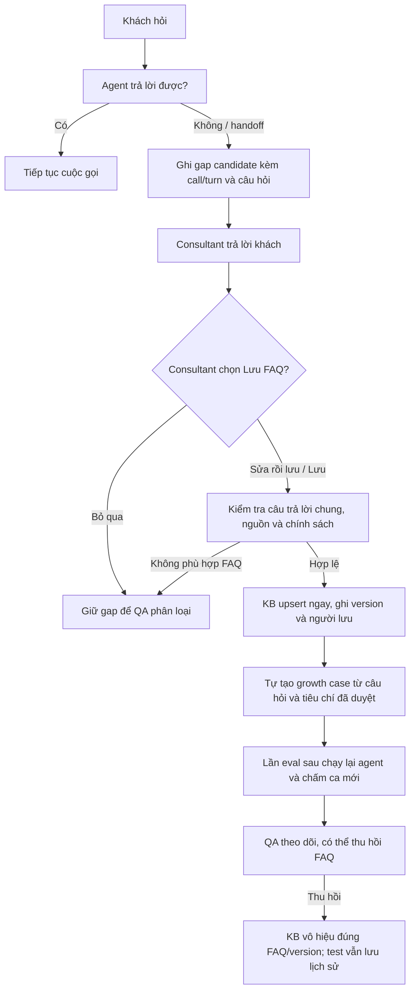

# Knowledge Gap Loop — luồng đã chốt

## Mục tiêu và ranh giới

Cải thiện câu trả lời bằng **tài liệu/KB và test**, không huấn luyện hay fine-tune mô hình. Consultant trả lời khách rồi chủ động chọn **Lưu FAQ** thì FAQ được đưa vào KB **ngay**; QA xem sau và có quyền thu hồi. Không tự biến mọi lần khách từ chối hoặc mọi handoff thành thiếu tri thức.

## Quy tắc phân loại

`gap candidate` chỉ là tín hiệu: agent nói rõ chưa có/không đủ thông tin hoặc gọi `handoff.transfer` thành công. Người duyệt phải phân loại trước khi lưu. Chỉ kiến thức **dùng chung, có nguồn kiểm chứng** mới thành FAQ. Giá, khuyến mãi, tồn kho, tình trạng đơn và dữ liệu của riêng khách cần tool/xác thực theo thời điểm; câu hỏi y tế hoặc ngoài chính sách tiếp tục handoff. Những ca agent có đủ dữ kiện nhưng không dùng là lỗi điều phối/retrieval, không phải thiếu FAQ.

## Ai làm gì, dữ liệu nằm ở đâu

| Bước | Hiện có trong `evaluation/` | Cần product của thầy |
| --- | --- | --- |
| Phát hiện | `score` ghi `scored/knowledge-gap-candidates.json`; `gap-scan` quét lại run cũ | Phát sự kiện không trả lời được/handoff có lý do ổn định, không chỉ dựa vào câu chữ |
| Câu trả lời người | Transcript giữ lời consultant nếu adapter phát ra; file review có tên người duyệt, nguồn và câu FAQ chung | Console ghi `call_id`, `turn_id`, câu consultant đã gửi, người gửi/thời gian; nút Lưu/Sửa/Bỏ qua |
| Tài liệu | `gap-publish` tạo `faq.md` candidate và `decision.json`, không chạm BTC/golden set | Khi consultant lưu, `kb.upsert` ngay, trả về FAQ id/version; advisor dùng `kb.search`; QA thu hồi được |
| Test | `growth-case.json` tự sinh khi review được duyệt; `gap-check` tự tìm mọi case và chấm câu trả lời được cung cấp | Chạy câu hỏi growth case qua agent/KB đang active và xuất câu trả lời có provenance cho evaluator |

Tài liệu mà agent cần dùng là **kho tri thức KB** của product, không phải `evaluation/evaluation-contracts/sources/btc/policy/faq.md`: file BTC là nguồn tham chiếu bất biến. `faq.md` do evaluation tạo hiện chỉ là candidate/hồ sơ bàn giao; nó **không tự lên KB** nếu chưa có điểm nối product.

## Cách chạy phần evaluation hiện có

1. Sau `evaluate`, đọc `runs/<run>/scored/knowledge-gap-candidates.json`. Với run cũ, chạy `run_eval.py gap-scan --run runs/<run>/evidence --out <file-mới>.json`.
2. Consultant/QA đối chiếu câu trả lời thật, nguồn sản phẩm và chính sách. Lập file review theo `knowledge-gap-review.example.json`; `must_say_any` là tiêu chí test do người duyệt đặt, không lấy nguyên câu trả lời mô hình làm ground truth.
3. Chạy `run_eval.py gap-publish --candidates <file> --review <file> --out datasets/growth/<gap-id>-v1`. Kết quả là phiên bản mới, không ghi đè. Đây là chuẩn bị cho KB, **chưa phải đã lên KB**.
4. Khi product đã chạy lại các câu hỏi, cung cấp JSON `{ "GAP-...": "câu trả lời agent" }` và chạy `run_eval.py gap-check --growth-root datasets/growth --responses <file>`. Lệnh trả `PASS`, `FAIL` hoặc `MISSING`; `MISSING` không bao giờ thành PASS. So khớp cụm từ chỉ là diagnostic, phải QA các trường hợp ngữ nghĩa/phủ định.

## Điều kiện để tuyên bố vòng lặp đạt

Phải có ít nhất một ca thật được ghi từ cuộc gọi, câu consultant và quyết định lưu có provenance; FAQ được truy xuất từ KB active ở lần sau; growth case được chạy với agent và có kết quả chấm; QA có thể thu hồi. Nếu thiếu bất kỳ mắt xích nào, báo **chưa end-to-end**. Run `20261010-173702` chỉ có 5 candidate do lời agent thiếu thông tin, không có handoff thành công hay câu consultant để duyệt; chưa thể tạo FAQ thật từ run này.
