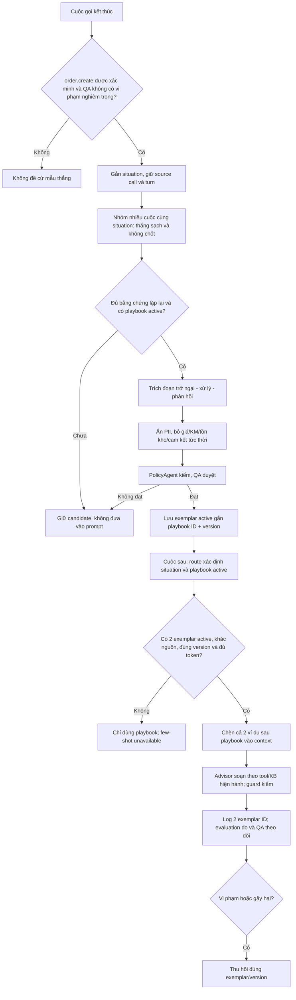

# Luồng Exemplar Bank từ cuộc gọi đến few-shot

Exemplar Bank là nhánh **đề xuất mở rộng** của Reflection: playbook nói *nên làm gì*, exemplar cho agent thấy *cách nói trong hội thoại*. Nó chỉ được gọi là few-shot khi **hai mẫu từ hai cuộc độc lập** cùng được đưa vào context của lượt trả lời. `docs/design.md` mục 10.5 hiện ghi chưa làm cơ chế này; sơ đồ dưới đây không phải trạng thái product đã triển khai.

## Đường ghi: từ cuộc gọi thành exemplar

Một cuộc chốt chỉ thành **candidate** khi có bằng chứng tạo đơn thật, không vi phạm chính sách/guardrail và nhãn `situation` rõ. Không tự đưa một cuộc thắng vào prompt. Đề xuất cổng mở duyệt là ít nhất 3 cuộc thắng sạch và 2 cuộc không chốt từ các cuộc/khách khác nhau cùng tình huống; ngưỡng này chỉ giúp tránh mẫu đơn lẻ, không chứng minh quan hệ nhân quả. QA chọn tối đa ba đoạn khác nhau cho một playbook version, mỗi đoạn tối đa bốn lượt thoại và 600 ký tự sau khi bỏ PII và dữ kiện chỉ đúng tại thời điểm gọi.

Record trong bank có `exemplar_id`, `playbook_id`, `playbook_version`, `situation`, `customer_signal`, `dialogue`, `source_call_id/turn_span`, bằng chứng outcome/QA, `status`, `version`, người duyệt và lịch sử thu hồi. Một exemplar thuộc đúng **một** playbook version. Playbook đổi version hoặc bị thu hồi thì exemplar cũ không còn được chọn cho đến khi QA duyệt lại. FAQ và playbook nằm trong KB tri thức; exemplar là kho ví dụ riêng, không để `kb_search` trả transcript như chính sách.

## Đường đọc: agent dùng hai mẫu trong một lượt

Route trước hết xác định `situation` và mục playbook `active` phù hợp. Bộ chọn lọc theo đúng `playbook_id + version`, chọn hai mẫu QA duyệt từ hai cuộc/khách khác nhau, ưu tiên `customer_signal` khớp lời khách; phá hoà ổn định theo ID. Không có playbook, thiếu hai mẫu, mẫu revoked hoặc không đủ token cho cả hai thì **không chèn exemplar**, chỉ dùng playbook. Tối đa hai mẫu mỗi lượt; không coi một mẫu là few-shot.

Context phân biệt rõ: **tool/chính sách/FAQ là nguồn sự thật; playbook là chỉ dẫn; exemplar là ví dụ cách nói**. Exemplar có mức ưu tiên thấp nhất và bị bỏ trước khi cắt các nguồn kia. Advisor không sao chép số tiền, cam kết hay thông tin riêng từ mẫu. Guard kiểm câu trả lời cuối. Trace phải ghi hai exemplar ID/version *thực sự được chèn*, không chỉ hai ID đã truy vấn.

## Đường kiểm chứng và thu hồi

Evaluation kiểm candidate, redaction, nguồn hai cuộc độc lập, khớp version và các ca 0/1/2 mẫu; một lượt chỉ được gắn nhãn `few_shot_used` khi cả hai mẫu nằm trong context. So cùng cohort `playbook-only` với `playbook + 2 exemplar`, chỉ đổi version bank; golden set dùng để đo chứ không để tuyển mẫu. Báo riêng tỷ lệ lượt dùng hai mẫu, task success, guardrail, hallucination giá/KM, latency/token và các growth case. Vi phạm nghiêm trọng phải thu hồi ngay mẫu liên quan; các suy giảm khác qua QA đối chiếu trước/sau. Không xoá transcript hay bằng chứng cũ.

## Phần bàn giao cho thầy và phần evaluation

Product cần kho exemplar/audit, cổng QA, chọn hai mẫu trong hot pipeline, context budget, trace usage và revoke. `evaluation/` có thể làm kiểm tra nguồn/PII, coverage 0/1/2 mẫu và báo cáo so sánh. Chưa có hai mẫu thắng sạch, độc lập và active cho cùng playbook thì cơ chế ở trạng thái **chờ dữ liệu**, không báo đã đạt yêu cầu few-shot. File kế hoạch bàn giao cho thầy được giữ local, không nằm trong repo này.
