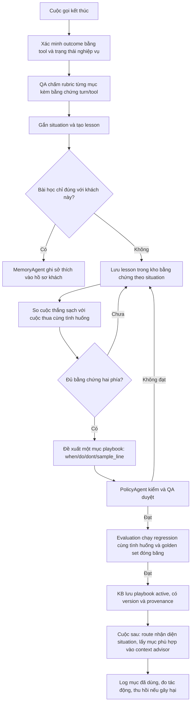

# Luồng Reflection từ cuộc gọi đến playbook

Reflection rút bài học từ các cuộc gọi để cải thiện **cách xử lý tình huống**, không huấn luyện lại mô hình. Một cuộc gọi chỉ tạo một phiếu bằng chứng; advisor không dùng lesson trực tiếp. Nhiều phiếu cùng tình huống, gồm cả thắng và thua, mới có thể tạo một mục playbook sau khi được kiểm tra, QA duyệt và evaluation kiểm chứng.



## Tầng 1: chấm cuộc gọi và tạo lesson

`after_call` là điểm bắt đầu: transcript, tool log và trạng thái đơn được giữ làm bằng chứng. Một cuộc **chốt thành công** phải có kết quả `order.create` được xác minh; lời agent hoặc outcome tự khai không đủ. QA chấm các mục rubric `PASS/FAIL` kèm trích dẫn lượt nói/tool, kiểm riêng vi phạm chính sách. Cuộc chốt nhờ hứa sai không được tính là bằng chứng thắng sạch.

QA gắn nhãn `situation` từ loại phản đối và bối cảnh, ví dụ `too_expensive`, `price_comparison` hoặc `family_decision`. Một lesson tối thiểu gồm:

```json
{
  "situation": "too_expensive",
  "outcome": "closed",
  "what_happened": "Khách lo giá; agent hỏi ngân sách trước khi đề xuất phương án.",
  "do": "Xác nhận ngân sách và kiểm tra phương án qua tool.",
  "dont": "Không tự hứa giảm giá.",
  "sample_line": "Dạ mình dự kiến ngân sách khoảng bao nhiêu để em tìm phương án phù hợp ạ?",
  "evidence": {"call_id": "CALL-123", "turns": [2, 3], "order_verified": true, "qa_violations": []}
}
```

Ví dụ trên minh hoạ **schema đề xuất**, không phải record hiện đã được tạo. Lesson riêng của một khách đi qua MemoryAgent vào hồ sơ khách; lesson có thể dùng chung đi vào kho bằng chứng `playbook/{situation}`. Lesson bị PolicyAgent gắn cờ vẫn được giữ cho QA xem, nhưng không được làm bằng chứng thắng sạch.

## Tầng 2: đối chiếu và xuất bản playbook

Gom theo `situation` chuẩn hoá, không chỉ theo tên sản phẩm hay từ khoá trong transcript. Trong mỗi nhóm, so một hành vi cụ thể giữa các cuộc **có làm/không làm**, tách cuộc thắng sạch khỏi cuộc thua và ghi số lượng thực tế. Mẫu nhỏ chỉ đủ tạo bản nháp để QA xem; không suy ra quan hệ nhân quả hay tự bật quy tắc từ một cuộc thắng.

Playbook là bản tổng quát `{situation, when, do, dont, sample_line, evidence, status, version}`. `sample_line` là một câu minh hoạ cách nói, không phải đoạn transcript dùng làm few-shot. PolicyAgent kiểm lời hứa, con số và xung đột chính sách; QA duyệt; evaluation chạy cùng cohort trước/sau khi đổi đúng một mục. Chỉ mục đạt mới gọi `kb_upsert(source="playbook", situation=...)`.

KB của product chứa **chính sách, FAQ và playbook**. Chính sách lấy từ tài liệu; FAQ và playbook cùng bảng `kb_chunks` nhưng phân biệt bằng `source`. FAQ cung cấp sự thật cần trả lời; playbook hướng dẫn cách xử lý tình huống. Ở cuộc sau, route nhận diện `situation`, lấy mục playbook `active` phù hợp, đặt sau quy tắc/brief/tri thức trong context budget rồi advisor soạn câu trả lời. Giá, tồn kho, trạng thái đơn vẫn phải lấy từ tool hiện hành. Ghi playbook ID đã dùng để đo tác động và thu hồi đúng mục nếu gây hại.

## Liên kết với evaluation và Exemplar Bank

Evaluation kiểm chứng outcome/tool, QA evidence, tính nhất quán của nhãn, nguồn lesson, kết quả regression và sự thay đổi R0 → R2 trên golden set đóng băng. Dữ liệu golden chỉ để đo, không làm nguồn sinh lesson. Growth cases mới dùng để kiểm tra lỗi/tình huống phát sinh; báo riêng với điểm golden.

Exemplar Bank là nhánh **tuỳ chọn khác**: sau khi đã có nhiều cuộc thắng sạch cùng tình huống, QA có thể chọn các đoạn đối thoại tiêu biểu. Lesson không tự biến thành exemplar. `sample_line` hoặc một exemplar đơn lẻ **không phải few-shot**; đề xuất chỉ kích hoạt few-shot khi có hai mẫu đã duyệt từ hai cuộc độc lập cho cùng phiên bản playbook. Xem [luồng Exemplar](EXEMPLAR-BANK-FLOW.md). Không cần xây bank riêng để hoàn thành Reflection.

## Trạng thái triển khai và ranh giới trách nhiệm

- **Đã có khung:** `after_call` gọi QaAgent; KB có `kb_chunks` và `kb_upsert/kb_search`; evaluation có bằng chứng tool/order và cơ chế so các vòng.
- **Chưa chạy end-to-end:** `QaAgent.score/reflect`, kho lesson, gom thắng/thua, duyệt playbook, chọn playbook theo `situation` trong hot pipeline và theo dõi/thu hồi tự động. Rubric product còn là khung. Không coi sơ đồ trên là trạng thái đã triển khai.
- **Trong `evaluation/` có thể làm:** kiểm chứng bằng chứng, schema/QA của dataset lesson, regression theo tình huống, so R0/R2 và báo cáo tác động. **Product của thầy cần làm:** sinh/lưu lesson từ cuộc gọi thật, approval, KB publish, retrieval theo tình huống và usage log. Không sửa nguồn BTC hoặc golden GT để tăng điểm.

Điều kiện tuyên bố đạt: truy được một chuỗi thực `call → QA evidence → lesson → đối chiếu thắng/thua → playbook đã duyệt → KB version → lượt sau truy xuất → regression → khả năng thu hồi`.
